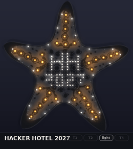
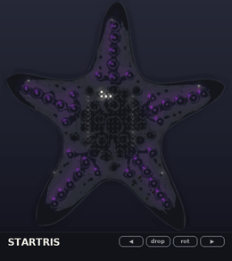
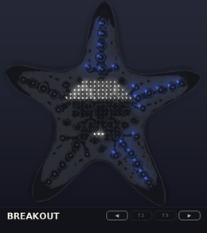
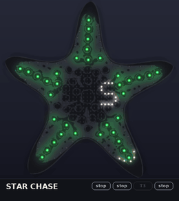
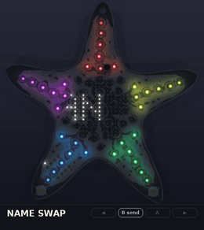
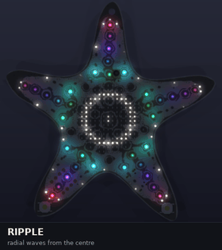
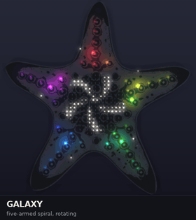
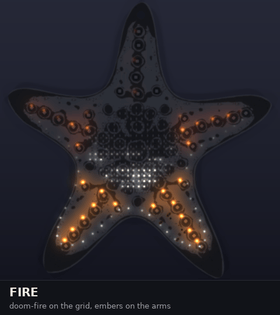
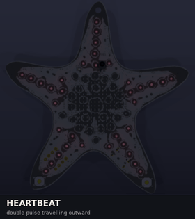

# hh27-starfish firmware (theoretical)

Embassy firmware for the Hacker Hotel 2027 starfish badge. It compiles, but it
has never run on a board.

| | | | | |
|---|---|---|---|---|
|  |  |  |  |  |
|  |  |  | | |
|  |  |  |  | |

Top two rows: recorded from the firmware itself, running on the PC
(`tools/fwsim`; the name swap from two C emulators), drawn on a KiCad
render of the board with the real LED positions: games and screens, then
the factory test, the sponsor reel and the bring-up test. Bottom row: the
Python animation sketches the firmware ports.

## Using the badge

**[docs/USAGE.md](docs/USAGE.md)** is the full guide: the buttons, the menu,
every game, the name tag and the emulator. The short version:

| | |
|---|---|
| **Hold A** | open the menu (from anywhere, also mid-game) |
| Menu | ◀ / ▶ previous / next, **A** select, hold A close |
| Name, hotel, animations | ◀ / ▶ previous / next screen, A brightness |
| Games | play themselves until you press ◀, ▶ or B |
| **Hold ◀ + ▶, 3 s** | reboot into the USB boot ROM for flashing |
| **B** on the name tag | send your name over infrared; a badge that gets it says HI with your name and sends its own back |
| **First power-on** | a freshly flashed badge runs a 30 s pass / fail factory test for the flashing table, and the power-on after it passed plays the sponsor reel once ([details](docs/USAGE.md#factory-test-the-flashing-table)) |
| **Hold A + B, 3 s** | bring-up test for a new board: COM / PWM / LED walks with designators on the UART, scan rate, IR loopback, power ([details](docs/USAGE.md#bring-up-test-first-boards)) |

◀ and ▶ are the two buttons on the front of the lower legs (thumbs), A and
B the two on the back of the side arms (A right, B left).

Type your name on the badge with **EDIT NAME** in the menu (◀/▶ letter,
A next, hold A save). It is kept in flash. Until then the badge shows the
build-time default: `BADGE_NAME="ANNE JAN" cargo build --release` (C:
`make -C c NAME="ANNE JAN"`).

## Setup page (WebUSB)

Both firmwares are a USB device with a small vendor protocol, and
[`docs/webusb/index.html`](docs/webusb/index.html) is a page that talks to it
from Chrome or Edge with WebUSB: set your name (saved in flash), pick what
the badge shows, set the brightness. It also shows the badge's state as it
changes. No driver install is needed on Linux and macOS; on Windows the
badge says so itself (Microsoft OS 2.0 descriptor, WinUSB).

Try it without a badge: `python3 tools/emu/emu.py c --web` (or `rust`) serves the page
on <http://localhost:8027/> and passes its packets to the emulated firmware,
so the page, the protocol and the badge's reaction are tested together.

The USB driver (`c/src/usb.c`, and `src/usb.rs` with byte-identical
descriptors) is ported from the ch32fun-based WebUSB test that the badge
team ran on a CH32X035, where it enumerated and passed bulk data. The
CH643's USB block has the same address and registers, but the port is
**not tested on a CH643 yet**. The protocol is in `c/src/proto.h` /
`src/proto.rs`; INFO says which firmware answers (`c` or `r`).
It uses the pid.codes test ID 1209:D035 for now; a real badge needs its own.

## Infrared and the UART console

**Name swap.** B on the name tag sends your name over infrared. A badge
that receives it shows "HI" and your name, and answers with its own name,
which yours then shows: one press, and both know who they met. The format
is NEC-style pulse-distance coding on 38 kHz, with a type, a length and a
CRC (`c/src/irproto.h`, `src/irproto.rs`). TIM1 CH4 makes the carrier on
PB23 in both. In C the SysTick compare interrupt switches it at each mark
and space and the receiver's edges come in on EXTI (`c/src/ir.c`); in
Rust, where Embassy owns SysTick, TIM3 times the marks and spaces and TIM2
CH4 captures the receiver's edges (`src/ir.rs`). The C driver is tested on
the PC against a fake SysTick and GPIO (waveform out decodes, distorted
edges in decode, own echo ignored); neither is tested on a badge. C and
Rust badges swap names with each other (checked in the emulator). Note the hardware issue below: the IR
receiver has no supply on the current board.

**UART console.** The UART header J3 (115200 8N1) prints a log (boot,
names saved, IR packets) and takes commands: `help`, `info`,
`name TEXT`, `show N`, `level N`, `hello`, `test`, `factory`,
`sponsors`.

Both work in the emulator: every emulator on a PC shares one infrared
"room" (UDP broadcast on 127.255.255.255:8028), so start two and press B
on one; stdin is the console and the log goes to stderr.

## Emulator

Either firmware can be built as a shared library and played on the PC:

```sh
make -C c emu && python3 tools/emu/emu.py c                     # C firmware
(cd tools/fwsim && cargo build --release) && python3 tools/emu/emu.py rust
```

The arrow keys are ◀ ▶ A B (← → ↑ ↓), and the buttons are drawn on the
board where they are; see
[docs/USAGE.md](docs/USAGE.md#emulator).

## Hardware

| | |
|---|---|
| MCU | WCH **CH643Q**: QingKe V4C RISC-V (RV32IMAC), 48 MHz, 62 KiB flash, 20 KiB RAM, LQFP64 |
| LEDs | 384 slots in a 24 × 16 matrix: PA0–PA23 drive the anodes (PWM), PB0–PB15 sink the cathodes (COM) |
| | 208 mono LEDs in a 17 × 16 grid, 71 mono LEDs on the outline, 35 RGB LEDs (7 per arm) |
| Buttons | ◀ SW3 PC5, B SW1 PB20, A SW2 PC4, ▶ SW4 PB18; active low, 10k pull-ups on the board |
| Power | LiPo (JST J2) with XT4054 charger and power path; CHRG on PB22; VBUS sense on PC3 |
| Debug | SWD header J4: 1 SWIO (PC18), 2 SWCK (PC19), 3 VCC, 4 GND |
| UART | header J3: 1 RX (PB17), 2 TX (PB16), 3 VCC, 4 GND; USART3. Log and console in C |
| IR | receiver CGQ1 (38 kHz) on PB19; IR LED D316, anode PB23 through 47 Ω, cathode PB21. Name swap in C |

## Build

```sh
cargo build --release            # stable Rust, target riscv32imc-unknown-none-elf
cargo run --release              # flashes over USB with wchisp, see Flashing
```

`src/generated.rs` contains the LED map. It is generated from the KiCad
board, so run this again after layout changes:

```sh
python3 tools/gen_layout.py      # needs KiCad's pcbnew Python module
```

The tools look for the board in a
[hackerhotel2027-hardware](https://github.com/badgeteam/hackerhotel2027-hardware)
checkout next to this repo, or in `$HH27_HW`.

The script follows every LED anode through its series resistor to a PA pin
and every cathode to a PB pin. It fails if two LEDs share one slot.

## Flashing

There are two ways in. With only a USB-C cable, through the CH643's
factory boot ROM (3328 bytes of system flash) and
[wchisp](https://github.com/ch32-rs/wchisp) (`cargo install wchisp`), as
below. Or with a WCH-LinkE on the SWD header J4 (SWIO, SWCK, VCC, GND),
which also gives a debugger. Pin 3 of J4 is the badge's VCC (battery or
USB, up to about 5 V), not 3.3 V.
wchisp lists the CH643 with USB and UART ISP support (`devices/0x24-CH643.yaml`).
USB-C D+/D− go straight to PC17/PC16, the CH643's USB pins.

```sh
wchisp probe
wchisp flash target/riscv32imc-unknown-none-elf/release/hh27-starfish
```

On Linux, give your user access to the boot ROM's USB ID (4348:55e0), for
example with a udev rule:
`SUBSYSTEM=="usb", ATTRS{idVendor}=="4348", ATTRS{idProduct}=="55e0", MODE="0666"`.

How the chip gets into the boot ROM (none of this is tested on a CH643 yet):

- **Blank chip**: on the CH32X035 the boot ROM always runs when the
  application flash is empty. The CH32X035 has the same core and memory map
  as the CH643 (ch32-data uses one memory file for both). If the CH643 does
  the same, new badges can be flashed straight over USB.
- **From firmware**: hold ◀ + ▶ for 3 s. The firmware does what WCH's
  `SystemReset_StartMode(Start_Mode_BOOT)` does (set FLASH_STATR.BOOT_MODE
  after the BOOT_MODEKEYR keys) and resets; the boot ROM then starts.
  See `src/bootloader.rs` / `c/src/bootloader.c`.
- **Pins**: on the CH32X035 the boot ROM runs when PC16 is low and PC17 is
  high at power-on. The badge has nothing that pulls PC17 high; with the
  SWD header that is no longer needed.

A firmware that crashes before it can jump to the boot ROM no longer bricks
the badge: the SWD header gets it back with a WCH-LinkE.

## Structure

| File | What |
|---|---|
| `main.rs` | Embassy main: render loop at 30 fps, event channel, CHRG monitor task |
| `buttons.rs` | Button polling task: debounce, press / tap / hold events, held buttons, the ◀ + ▶ chord |
| `app.rs` | Menu, the list of screens, brightness, charging overlay |
| `nametag.rs` | Name tag and Hacker Hotel 2027 screens, the `Name` type |
| `editor.rs` | Name entry on the badge (EDIT NAME) |
| `store.rs` | The name and the first-boot stage in flash (last 256-byte page; `memory.x` keeps code out of it) |
| `anim.rs` | Animations: ripple, galaxy, heartbeat, life, fire, twinkle, charging |
| `game.rs` | Game shell: demo mode, play, crash, score screen |
| `games/` | Snake, Startris, Breakout, Pong, Flappy, Star Chase |
| `frame.rs` | Frame buffer, text and digits, integer HSV, sine, RNG |
| `font.rs` | 5x7 font (` `..`Z`), 3x5 digits |
| `ledpwm.rs` | CH643 LEDPWM driver, from the reference manual: one interrupt per row, double-buffered frames |
| `bootloader.rs` | Reboot into the USB boot ROM |
| `generated.rs` | LED map, polar coordinates, gamma and sine tables (generated) |
| `usb.rs`, `proto.rs` | USB device on the registers (WebUSB setup page), and its protocol |
| `ir.rs`, `irproto.rs` | Infrared: TIM1 carrier, TIM3 timing, TIM2 capture; packets and pulse decoder |
| `uart.rs`, `console.rs`, `log.rs` | UART header: the log out, console commands in |
| `selftest.rs` | Bring-up test for new boards |
| `factory.rs` | Factory test for the flashing table (first power-on until it passes) |
| `sponsors.rs` | Sponsor reel (the power-on after the factory test), with the sponsor table |

`c/` has a port of the same firmware to plain C (register level, no WCH
peripheral library), for comparison; see `c/README.md` and the sizes below.

## Tools

| | |
|---|---|
| `tools/emu` | Live emulator for either firmware, built as a shared library (see Emulator); `--web` serves the setup page against it; `--fresh` starts as a freshly flashed badge (factory test, then sponsor reel); emulators share infrared, stdin is the UART console |
| `tools/fwsim` | `cargo test` checks the name editor. Runs the firmware's hardware-independent modules (app, menu, games, animations) on the PC, from the same sources. `soak` plays every item with random presses in a debug build, where integer overflow and out-of-range indexing panic; `record` writes frames for `fwgif.py`. Also builds the Rust library for the emulator. Run it from its own directory: `cd tools/fwsim && cargo run -- soak` |
| `tools/sim/logo.py` | Turns a picture into a sponsor logo for the grid (rows for `sponsors.c` / `sponsors.rs`) |
| `tools/sim/fwgif.py` | Turns a `fwsim record` (or frames from the C emulator library) into a GIF on the board render |
| `tools/sim/hh2027.py` | Animation sketches on a KiCad 3D render of the board (GIF + MP4 into `previews/`); `--refresh` re-reads the board (kicad-cli + pcbnew) |
| `tools/sim/games.py` | The first game mock-ups, played by a scripted AI |
| `tools/gen_layout.py` | LED map from the KiCad board, for Rust and C |

The Python tools need numpy, scipy, Pillow and ffmpeg.

## Size

Everything above (name tag and name entry, hotel screen, menu, 6
animations, 6 games, the USB boot gesture, the USB device, the infrared
name swap, the UART console, the bring-up test, the factory test and the
sponsor reel), measured. The last 256 bytes of flash are kept for the
saved name and the first-boot stage.

| | Flash (of 62 KB) | Static RAM (of 20 KB) |
|---|---|---|
| C, GCC 15 `-Os` | **34.5 KB** (56%) | 6.5 KB + 2 KB stack |
| Rust + Embassy, `opt-level = "z"` (default) | **48.1 KB** (78%) | 4.7 KB + stack |
| Rust + Embassy, `opt-level = "s"` | 53.2 KB (86%) | 4.7 KB + stack |

Rust builds with `opt-level = "z"` since the factory test: with `"s"` it
would be at 86%. The factory test and the sponsor reel cost 3.3 KB in C
(the test 2.4 KB, a third of it the volunteers' hints in the log; the reel
0.65 KB without logos) and 3.9 KB in Rust. A logo is 64 bytes.

Roughly where the C flash goes: animations 4.0 KB, the app (menu, USB
settings, infrared greeting) 3.4 KB, Startris 2.5 KB, LED tables 2.2 KB,
Snake 1.8 KB (its demo path search included),
Pong / Star Chase / game shell / name tag / Breakout about 1.1 to 1.3 KB
each, Flappy 0.7 KB. The 5x7 font is 295 bytes.

USB in C is 2.3 KB: the driver about 1.25 KB, descriptors 0.3 KB (the
Windows part 195 bytes), the protocol 0.4 KB, and 326 bytes of RAM.
Infrared and the UART console add 4.2 KB (IR driver 1.1 KB, pulse codec
0.7 KB, UART 0.5 KB, console 1.0 KB, the greeting in the app about 1 KB)
and 0.85 KB of RAM, mostly the UART's 512-byte send buffer. Without
USB, IR and UART, C is about 22 KB, and Rust is about 1.6 times that: about 3 KB of Embassy executor, timer
and HAL interrupt code, the rest is code generation. There is room left for
more games either way.

## What is solid and what is guessed

**Solid**

- ch32-hal has a `ch643` feature (Embassy time driver, RCC, GPIO, ADC, timers).
  The dependency is pinned to commit `4fde792`, because CH643 support is not on
  crates.io yet.
- The LED map is traced from the PCB nets.

- **LEDPWM**, from the CH643 reference manual (CH643RM V1.9, chapter 24).
  The board is its "8 columns RGB, built-in drive" case; reference circuit
  24.4.2 is 16 rows x 8 RGB columns, as here. MATRIX_MODE PA24, PA pins
  active high, PB COM lines active low, one interrupt per row in which
  the driver DMA-loads the next row (8 words: intensity, PA k, PA k+8,
  PA k+16) and selects the next COM. The brightness is the intensity PWM.
- **Remaps** (RM 8.3.2.1): USART3_RM = 11 puts TX/RX on PB16/PB17, and
  TIM1_RM = 1xx puts CH4 on PB23, which now makes the IR carrier.
  (ch32-data's CH643 tables stop at USART3 remap 2 and TIM1 remap 3.)
- **SysTick** (QingKe V4 manual, chapter 5): with STRE = 0 the counter runs
  on past the compare value and sets CNTIF there, as `ir.c` uses it.

**Guessed** (each place is marked `GUESS` in the source)

- **LEDPWM details** the manual leaves open: that the LED reference clock is
  HCLK (it sets the 183 Hz scan rate), that a 6-bit intensity uses the low
  6 bits of the intensity byte, and that the DMA address is the low 16
  bits of a RAM address. All in `ledpwm.rs` / `c/src/ledpwm.c`.

## Hardware notes found along the way

- **Unbonded and unused pads.** WCH's SystemInit pulls up the pads that the
  LQFP64 package does not bond out (PC6–PC9, PC12, PC13, PC20); if they
  float they draw current. ch32-hal does not do this, so `main.rs` does it,
  and pulls up PC0–PC2 too, which the board leaves unconnected since the
  touch pads went. PC3 (VBUS sense) must stay a floating input.
- **IR receiver has no supply** (hardware commit c388024). Its VCC (through
  R36) and the IR_RECV pull-up R35 are on a `+3.3V` net that nothing
  drives: there is no regulator. Probably meant to be VCC.
- **VBUS straight into PC3.** VCC is VBUS minus a Schottky drop, so PC3
  sits a little above VDD while USB is in; the datasheet allows at most
  VDD + 0.3 V on an I/O pin (CH643DS0 3.2). A divider would be safer.
- **IR LED current.** The anode hangs off PB23 through 47 Ω. The datasheet
  allows a PB pin to source at most 30 mA (absolute maximum), and only
  12 mA at VDD − 0.4 V; PB pins are made to sink (100 mA). Better: anode
  to VCC through the resistor, cathode on PB21, carrier from TIM2 CH1
  (TIM2_RM = 001 puts CH1 on PB21).
- **No battery gauge.** The board has no battery-voltage sense, so the
  firmware can show *that* the battery charges but not *how full* it is.
- **USB in Rust.** ch32-hal has no USB driver for the CH643, so `src/usb.rs`
  drives the USB block on its registers, polled from a task every 0.5 ms,
  like the C driver (not embassy-usb).
