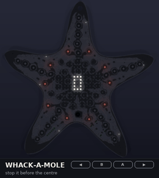
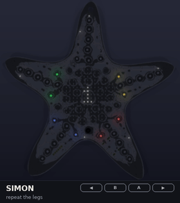
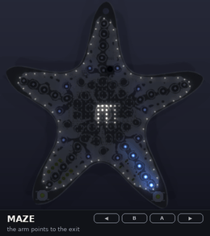
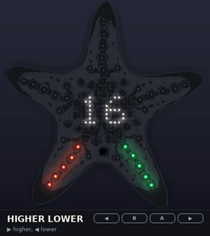
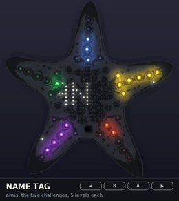
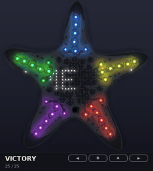
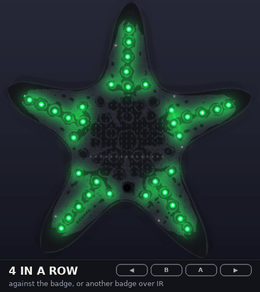
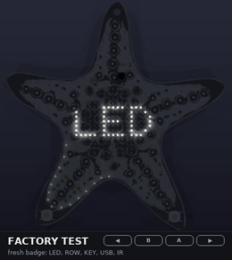
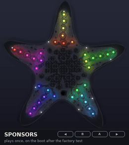
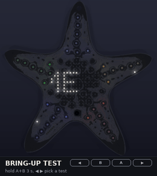

# Using the starfish badge

This guide covers the firmware in this repo (Rust in `src/`, C in `c/`).
Both versions behave the same, apart from a few words on the UART console
(noted there) and the USB boot screen, which is one frame shorter in C.
Nothing here has run on a real badge yet.
To try it on a PC, use the [emulator](#emulator).

## The buttons

The badge has four push buttons. Hold the badge by its two lower legs: your
thumbs are on the front buttons, your index fingers reach the two on the
back.

| Button | Where | Mostly used for |
|---|---|---|
| **◀** | front, lower left leg (SW3) | previous, left |
| **▶** | front, lower right leg (SW4) | next, right |
| **A** | back, right arm (SW2) | select; hold for the menu |
| **B** | back, left arm (SW1) | drop in Startris, previous position in EDIT NAME |

| Press | What it is |
|---|---|
| **Tap** | Press and let go within 0.6 s. |
| **Hold** | Keep it down for 0.6 s. The hold happens while you press; it does not wait for you to let go. |
| **Press** | The moment the button goes down. Games use this, so they react without waiting for you to let go. |
| **Chord** | Two or more buttons down at the same time. A chord does not count as a tap or a hold. |

So to hold a button, hold that button **alone**. If another button is also
down, it is a chord: neither button taps or holds. Each press still
counts, though, so a game still sees it.

## Always available

| Do this | What happens |
|---|---|
| **Hold A** | The menu opens. This works from the name tag, the Hacker Hotel screen, the animations, VICTORY and the games, also in the middle of a game. In EDIT NAME hold A saves, and in the bring-up test it leaves the test. It does nothing during the factory test, the sponsor reel or the victory dance you earn with the last challenge, or while a greeting or the charging screen shows: tap to end those first. |
| **Hold ◀ + ▶ for 3 s** | The badge reboots into the USB boot ROM for flashing. An arrow runs down the grid for a second first. See [Flashing](../README.md#flashing). |
| Plug in USB | While the battery charges, a battery on the grid fills up, over and over (the badge cannot tell how full the battery is). Tap any button to hide it. It does not show over a game that you are playing, the menu, EDIT NAME or the bring-up test. |

## The menu

Hold A to open the menu. The item's name shows on the grid. Long names
scroll. The outline shows where you are in the list. The arm colour shows
the group:

| Arm colour | Group |
|---|---|
| Orange | Name tag, Hacker Hotel |
| Purple | Animations, Victory |
| Green | Games |
| White | Edit name, Light |

| In the menu | |
|---|---|
| ◀ / ▶ | Previous / next item |
| Tap A | Select the item, and close the menu |
| Hold A | Close the menu and keep what was running |
| No button for 20 s | The menu closes |

The items, in order:

1. **NAME**: your name tag. The badge starts on this screen.
2. **HACKER HOTEL**: "HH" over "2027", then "HACKER HOTEL 2027" scrolls
   by. The outline runs marquee lights like a hotel sign.
3. **RIPPLE**, **GALAXY**, **HEART**, **LIFE**, **FIRE**, **TWINKLE**:
   animations.
4. **SNAKE**, **STARTRIS**, **BREAKOUT**, **PONG**, **FLAPPY**,
   **STAR CHASE**, **WHACK-A-MOLE**, **SIMON**, **MAZE**,
   **HIGHER LOWER**, **4 IN A ROW**: games. Five of them are the
   [challenges](#challenges); 4 in a row can also be played against
   [another badge](#4-in-a-row-against-another-badge).
5. **VICTORY**: the victory dance, once you have done all the challenges.
   Until then it shows how far you are (out of 25).
6. **EDIT NAME**: type your name on the badge, see [Your name](#your-name).
7. **LIGHT**: brightness. Tap A to step through five levels: night,
   5%, 12.5%, 31% and full LED power. A bar on the grid shows the level.
   The menu stays open, so you can step again. The badge starts at 12.5%,
   because bare LEDs at close range are bright. Full power is for
   daylight, and it drains the battery fastest.

## Name tag, Hacker Hotel and the animations

| Button | |
|---|---|
| ◀ / ▶ | Previous / next screen. This skips EDIT NAME and LIGHT, and it stops at the games, because a press starts a game. |
| Tap A | Brightness, the same five levels as LIGHT |
| Hold A | Menu |

## Games

### Demo mode

Every game starts in **demo mode**: the game plays itself, and a dim
light runs slowly round the outline (not in Star Chase, Maze and Higher
lower, which use the outline themselves). **Press ◀, ▶ or B to start a
real game.** A does not start a game. In demo mode, tap A for brightness
or hold A for the menu.

At game over, the arms flash red and your score shows on the grid. Then
the game goes back to demo mode. If you win at Pong, or solve all five
mazes, the arms do not flash red.

### Leaving a game

**Hold A** (alone) to open the menu, then pick something else. In a game,
A goes to the game the moment you press it: Startris rotates the piece,
Maze moves down, Simon takes it as one of its four buttons, and
Whack-a-mole as a stop like any button. The other games ignore it. In
those four, the press that starts a hold is a move too: in Simon it can
be a wrong button, and in Whack-a-mole, while nothing is lit, it ends
the game.

### The games

| Game | Buttons | Score |
|---|---|---|
| **Snake** | ◀ turns left, ▶ turns right. You can press two turns ahead. | The food you eat, shown in green on the arms. From a score of 10, the snake moves faster. |
| **Startris** | ◀ / ▶ move the piece (hold to repeat). Tap A to rotate, B to drop. | The lines you clear. The arms also show the colour of the next piece. |
| **Breakout** | ◀ / ▶ move the paddle. Hold to keep it moving. | The bricks you break fill the arms in orange from the top arm on, one LED for every 3 bricks. Your lives (3) light whole arms in dim blue: the top one and the two on the right, under the orange. When all the bricks are gone, a faster wave starts. |
| **Pong** | You play against the badge. ◀ moves your paddle (left side) up, ▶ moves it down. Hold to keep it moving. | Your points show in blue on the left arms, the badge's in red on the right arms. First to 5 wins. |
| **Flappy** | Press ◀, ▶ or B to flap. | The pipes you pass, in gold. |
| **Star Chase** | A light runs round the outline. Press ◀, ▶ or B when it is beside the arm that shows green. | The grid shows your level. Each hit makes the light faster, up to a limit. After 3 misses, the game is over. |
| **Whack-a-mole** | A random arm lights up from its tip towards the centre. Press any button to stop it. Pressing while nothing is lit ends the game. | The sooner you stop it, the more points: 5 with one LED lit, 2 with four. It gets faster every 3 hits. When the light reaches the centre, the game is over. |
| **Simon** | The badge lights a sequence on the four legs that have a button: ◀ lower left, ▶ lower right, A upper right, B upper left (A and B are on the back of those arms). Press it back. | The length you repeated. Each round adds one. The top arm fills as you enter the sequence, and lights green for 0.6 s when you got it all. A wrong button, or 5 s without one, ends the game. |
| **Maze** | You stay in the middle of the grid and the maze moves around you; only the walls close by are lit. ◀ / ▶ left / right, B up, A down (hold to repeat). The arm that lights up points towards the exit, in the far corner. | Five mazes, from 5 x 5 to 13 x 13 cells, each with a time limit (15 s, then 8 s more per maze) shown on the outline. The side LEDs of an arm turn green for every maze solved. |
| **Higher lower** | A number from 1 to 99. Will the next one be higher (▶, its leg lights green) or lower (◀, red)? | Your streak of right guesses fills the outline, 5 LEDs a point. One wrong guess and the game is over. |
| **4 in a row** | Seven columns, six high. ◀ / ▶ move your disc along the top, B drops it. Four of yours in a line (across, up or diagonal) wins. Your discs are bright, the other side's dim; the arms are green on your turn, orange on theirs. Against the badge, or [another badge](#4-in-a-row-against-another-badge). | When you win: the discs you had left in hand (up to 17). |

The playing field is the octagon in the middle, and its edge is the wall.

|  |  |  |  |
|---|---|---|---|

## Challenges

Five games are challenges, one for every arm, with five levels each: one
for every LED in the line along the arm. On the **name tag**, the arms
show how far you are, so you can compare with other people:



| Arm | Colour | Challenge | Levels (the score you need) |
|---|---|---|---|
| Top | blue | Maze | mazes solved: 1, 2, 3, 4, 5 |
| Upper right (A) | yellow | Simon | sequence length: 4, 6, 8, 10, 12 |
| Lower right (▶) | red | Whack-a-mole | points: 20, 40, 60, 80, 100 |
| Lower left (◀) | purple | Higher lower | streak: 3, 5, 7, 9, 12 |
| Upper left (B) | green | Snake | food eaten: 5, 10, 15, 20, 30 |

A level counts when a real game (not the demo) ends with that score; a
worse game never takes a level away. The score screen shows the arms
with the new level blinking. A finished challenge makes the two LEDs
beside its line shimmer. Progress is kept in flash, next to the name, so
it survives power off and firmware updates (`wchisp erase` clears it).
`progress` on the UART console lists it.

All 25 levels, and the badge does its **victory dance**: a stick figure
dances on the grid, a new move on every beat (arms up and down, disco
points, squats, jumps, kicks, and of course Y M C A), while the arms flash
disco colours on the beat. Between the dances, "I'VE COMPLETED / ALL THE
CHALLENGES / AND ALL I'VE GOT / IS THIS LOUSY / LED ANIMATION!" bobs by a
phrase at a time, with fireworks on the arms and the outline. Tap to stop
it. VICTORY in the menu plays it again, over and over.



## Your name

### Typing it on the badge

Open the menu (hold A), go to **EDIT NAME** and tap A. The name shows on
the grid. The character you are changing is bright in the middle, with a
blinking line under it. The outline shows how far into the name you are.

| Button | |
|---|---|
| ◀ / ▶ | Previous / next character. Hold to keep going. |
| Tap A | Next position. One blank after the end, it goes back to the first character. |
| Tap B | Previous position |
| **Hold A** | Save, and show the name tag |

The characters come in this order: blank, `A`–`Z`, `0`–`9`, then
`- . ! ? ' * : / # @`. From a blank, ▶ gives `A`. To make the name
shorter, set the characters at the end to blank. Names are up to 24
characters long.

If you press nothing for a minute, the editor closes and does not save.

The name is kept in flash, so it is still there after you switch off.
Two pages take turns, so even a flat battery in the middle of a save
keeps the name you had before. A firmware update with `wchisp flash` keeps it;
`wchisp erase` clears it. Saving to flash is not tested on a badge yet.

A new name, from EDIT NAME, the console or the setup page, is written to
flash at most once every 5 s, so a script that renames the badge over and
over does not wear the flash out. The last name always gets written.

### The default

Until you save a name, the badge shows the name the firmware was built
with:

```sh
BADGE_NAME="ANNE JAN" cargo build --release      # Rust
make -C c NAME="ANNE JAN"                        # C
```

The font has upper-case letters, digits and ` !'*-.:?/#@<>`. Lower case shows
as upper case. Names up to 3 characters stand still. Longer names scroll.

## Meeting other badges (infrared)

On the name tag, **tap B** to send your name over infrared. Point the top
of your badge, where the IR LED and receiver sit, at the other badge. A
white wave runs out along your arms for a second as it sends (the
packet itself takes up to half a second, longer for a longer name).

The badge that receives it shows **HI**, then your name, with colours
running round its arms, and sends its own name back; your badge then
greets that one the same way. So one tap and both badges know who they
met. Tap any button to close a greeting early.

A greeting waits while the menu or EDIT NAME is open or a game is being
played, and shows when you are done. The answer goes out straight away.

### 4 in a row against another badge

Open **4 IN A ROW** on both badges and point them at each other. Press
◀, ▶ or B on one of them: its arms sweep blue while it looks for a
partner, and the other badge joins by itself (it only needs to show the
game, even its demo). The badge that asked moves first; the UART log
says `four: linked, you start` or `they start`. If you drop a disc
before another badge answers, you play against your own badge instead.

Each move goes over infrared as soon as you make it, and again every
0.8 s until the other badge has it, so keep the badges pointed at each
other. While it is the other player's turn, your badge checks every 3 s
that theirs is still there; after 20 s without an answer (they walked
off, or opened the menu) the game ends with `four: link lost`. Both logs
end with the result and every move, for example
`four: you win, moves 4455463` (columns 1 to 7).



Not tested on a badge yet. It needs a board with the IR LED and the
receiver fitted. The receiver's missing supply is fixed in hardware
commit 0986add (see the
[hardware notes](../README.md#hardware-notes-found-along-the-way)), so
prototypes from that revision on should both send and receive.

## UART console

The UART header J3 (pin 1 RX, pin 2 TX, pin 4 GND; 115200 baud, 8N1)
prints a log: the name at power on, names saved, infrared packets sent
and received. Type a command and Enter (pasting a whole line works too):

| Command | |
|---|---|
| `help` | the commands and the list of items |
| `info` | firmware, name, what is showing, brightness |
| `name TEXT` | set the name, saved in flash like EDIT NAME |
| `show N` | show item N (`help` lists them; not EDIT NAME or LIGHT). For an item it cannot show, C says `? try help`, Rust `? not an item to show (see help)` |
| `level N` | brightness, 0 (night) to 4 (full) |
| `hello` | send the name over infrared, as B on the name tag does |
| `test` | the [bring-up test](#bring-up-test-first-boards) |
| `factory` | the [factory test](#factory-test-the-flashing-table); `factory skip` marks it as passed without running it |
| `sponsors` | play the [sponsor reel](#sponsor-reel) again |
| `progress` | the [challenges](#challenges): each one's level, and the total out of 25 |

Pin 3 of J3 is the badge's VCC (battery or USB), not
3.3 V: do not connect it to the adapter's supply.

## Factory test (the flashing table)

A freshly flashed badge starts with a short factory test, made for
volunteers at the flashing table: about 30 seconds per badge, pass or
fail, no serial terminal needed. It comes back at every power-on until it
has passed once. The badge keeps that in flash, with the name. A later
`wchisp flash` keeps it, so an update does not bring
the test back; `wchisp erase` does. To run it again on purpose, type
`factory` on the UART console.



Each step shows its name for a second first. The outline fills up as the
steps go by.

| Step | The badge shows | You do |
|---|---|---|
| **LED** | Every LED on: white, then the arms red, green, blue, over and over | All lit, right colours: tap **B**. Something dark or the wrong colour: tap **A** |
| **ROW** | One row lit, moving top to bottom, then one column, moving left to right, then a few sets of dots on the outline and arms | Always exactly one row, column or set of dots, never two, none missing: tap **B**. Otherwise tap **A** |
| **KEY** | `<` `B` `A` `>` dimmed | Press each button once; each lights up. Goes on by itself |
| **USB** | `USB`, blinking until it sees USB power | Keep it plugged in. Goes on after a second of USB power |
| **IR** | Heard (top) and sent (bottom) test packets | Nothing. It passes on its own echo, or on test packets from another badge nearby |
| **OK** | Green arms, `OK` | Done. After 3 s the badge goes to its name tag |

A failed step blinks red arms and shows the step's name: put the badge
on the repair pile. Tap **B** to try that step once more. KEY fails after
20 s and USB and IR after 10 s; the UART log says what was missing
(`factory test: FAIL at KEY: missing: < . A .`).

The IR step needs the IR LED and the receiver on the board. With the
receiver's supply fixed (hardware commit 0986add, see the hardware notes
in the README), expect it to pass on prototypes.

Holding **A + B for 3 s** leaves the factory test for the full bring-up
test below. The badge then runs the factory test again at the next
power-on.

### Card for the flashing table

> 1. Flash the badge. Keep it on USB. It starts the test by itself.
> 2. **LED**: every LED lit? Arms go red, green, blue? Yes: **B**. No: **A**.
> 3. **ROW**: one line moving at a time, never two? Yes: **B**. No: **A**.
> 4. **KEY**: press ◀, B, A and ▶ once each.
> 5. **USB** and **IR** go by themselves. Keep it on USB.
> 6. Green **OK**: good badge. Red: repair pile.

## Sponsor reel

The first power-on after the factory test passed (in practice: when the
attendee first switches it on) plays a short sponsor reel once: "THANKS
TO", then each sponsor's logo scrolling by in greyscale, with the arms in
the sponsor's colours. Any tap skips it.
After that it never plays by itself again; `sponsors` on the UART console
plays it on demand.



The reel is a table at the top of `c/src/sponsors.c` and
`src/sponsors.rs`: each item is a text or a logo, and how the arms light
up. For now:

| Sponsor | On the grid | Arms |
|---|---|---|
| ALLNET | a glimpse of the globe (taller than the grid, panned diagonally as it scrolls), then the word | a blue wave |
| badge.team | the word mark | a rainbow sweeping diagonally across the star |
| Nicolai Electronics | icon and name | an orange and grey wave |
| deFEEST | the name, its outline letters filled | a yellow and blue wave |

The logos come from the SVGs in `assets/sponsors`. To add or change one,
put the SVG (or a PNG) there, add a line to the `LOGOS` table in
`tools/sim/logo.py` (how many grid rows it gets, an optional crop, the
ink: alpha, white, or a colour for outline letters to fill, and a
brightness floor) and run it; it needs Inkscape and scipy:

```sh
python3 tools/sim/logo.py --preview=logos.png   # writes c/src/logos.h and src/logos.rs
```

A logo pixel's brightness is how much of it the picture covers, in four
steps; lone specks are dropped. A logo that fits the grid stands in the
middle for 2.5 s, fading in; a wider one scrolls by like text, and one
taller than the grid also pans from its top to its bottom. Word marks
work best at 9 to 16 rows; thin lines and small text get lost, so the
ALLNET globe is redrawn in the tool with fewer, thicker lines, and
deFEEST's outline letters are filled. A logo costs a quarter byte a
pixel: 95 to 240 bytes each.

## Bring-up test (first boards)

For checking a freshly built board: **hold A + B for 3 s**,
or type `test` on the UART console. Connect a serial terminal to J3 to
see what each step should look like; every step and every button event
is logged there. ◀ / ▶ go to the previous / next test, **hold A** leaves.



| Test | On the badge | In the log |
|---|---|---|
| COM | all 24 PWM channels on one COM line, stepping PB0..PB15 twice a second | `COM PB3 on` |
| PWM | one PWM channel on all COM lines, stepping PA0..PA23 | `PWM PA7 on` |
| LED | one LED at a time, 4 a second. B pauses; while paused, tap A steps | `slot 41: PB1 PA17 D35 green` |
| ALL | every LED on at the current brightness: measure the current here | the brightness level |
| GRY | grey ramp left to right on the grid; arms red, green, blue, white, orange | `grid: grey ramp left to right; arms red, green, blue, white, orange` |
| KEY | the buttons held, as L, B, A, R; no name first, so a press shows at once. Holding A still leaves the test | |
| SCN | LED rows per second | `scan: 2930 rows/s` means the LED clock is the 48 MHz HCLK |
| IR | sends a test packet every 2 s and counts how many it hears back (top: heard, bottom: sent) | `ir: heard 3 of 3 sent` |
| PWR | USB or BAT, and CHG while charging | `power: USB (PC3 high), charging (CHRG low)` |

The LED test names the designator of every slot (from the KiCad board),
so a dead LED or a swapped net shows up as "D35 should be on". The scan
rate checks the one timing guess in the LED driver. The IR test hears the
badge's own LED, so it tests sender and receiver together (it needs the
IR LED and the receiver on the board).

## Setup page

Plug the badge into a computer and open the setup page,
[`docs/webusb/index.html`](webusb/index.html), in Chrome or Edge. Firefox
and Safari have no WebUSB. Click **Connect badge (USB)** and pick the
badge. Then you can:

- type your name and click **Save**. It is saved in flash, the same as
  EDIT NAME.
- pick what the badge shows (all screens and games, except the menu-only
  entries EDIT NAME and LIGHT).
- set the brightness.

The page reads the badge's state (what it shows, the brightness,
charging) every second, so changes made with the buttons show up on the
page as well. The name is read only when you connect: to see a name
changed on the badge, connect again.

On Linux, give your user access to the badge's USB ID (1209:D035), for
example with this udev rule:
`SUBSYSTEM=="usb", ATTRS{idVendor}=="1209", ATTRS{idProduct}=="d035", MODE="0666"`.

The USB part is not tested on a badge yet.

## Emulator

The emulator runs the real firmware code on a PC. The C or Rust firmware
is built as a shared library, and `tools/emu/emu.py` draws the LEDs live
on a picture of the board, with the four buttons where they are on the
badge (the two on the back drawn dashed):

```sh
make -C c emu && python3 tools/emu/emu.py c
(cd tools/fwsim && cargo build --release) && python3 tools/emu/emu.py rust
```

| Key | |
|---|---|
| `←` / `→` | ◀ / ▶ |
| `↑` or `A` | A |
| `↓` or `B` | B |
| click | You can also click the buttons on the board. |
| `C` | USB power on / off (charging) |
| `R` | Reset (power on again). The firmware then starts without USB power, whatever the status line says: if `C` was on, press it twice |
| `Esc` | Quit |

The keys follow the same tap / hold / chord rules as the badge. Hold `↑`
and `↓` together for 3 s for the bring-up test. To open the
menu from a game, hold `↑` alone for 0.6 s. Hold `←` and `→`
together for 3 s to see the USB boot screen. The emulator then powers the
firmware on again. A name saved with EDIT NAME stays saved over `R` and the
reboot, as it would in flash. It is lost when you close the emulator.

Every emulator on the PC shares one infrared "room"
(UDP broadcast on 127.255.255.255:8028; `--no-ir` leaves it). Start two,
press `B` on one's name tag, and they swap names. Lines typed into the
terminal go to the badge's UART console (try `help`), and the badge's log
appears there too.

With `--fresh`, the emulator starts as a freshly flashed badge: the
factory test first (`C` is the USB power it waits for), and after `R` the
sponsor reel. Without it, the emulator is a badge that has been through
both.

With `--web`, the emulator also serves the setup page on
<http://localhost:8027/> and opens it in the browser (`--no-browser`
leaves that to you). Click **Connect emulator** there: the page then
talks to the emulated badge the same way it talks to a real one over USB.

The emulator needs Python with tkinter, numpy, scipy and Pillow. The
interface between the emulator and the firmware is in
`tools/emu/badge_emu.h`.
